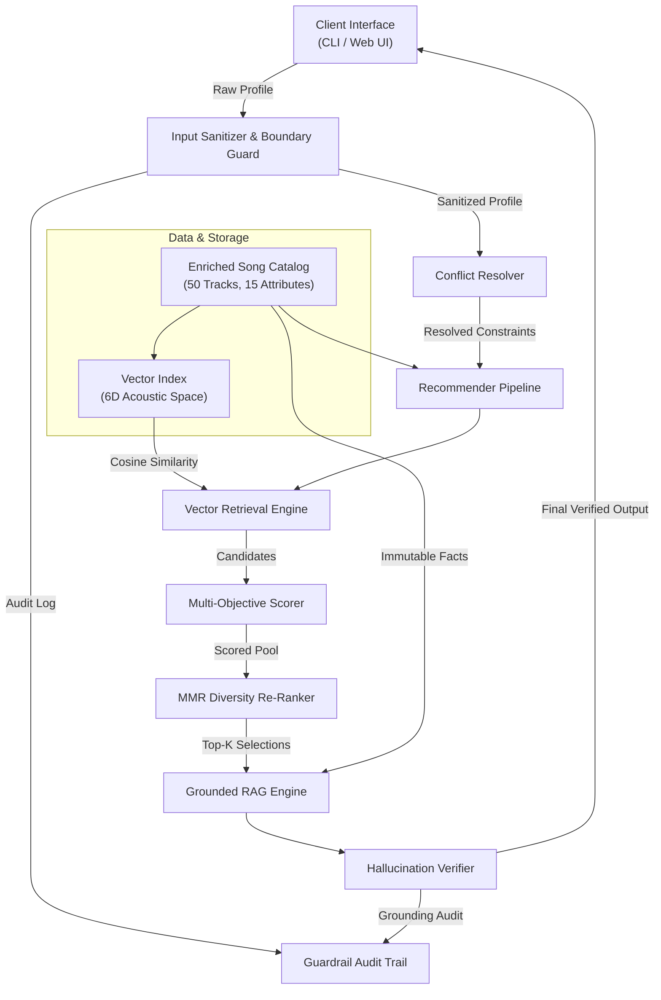
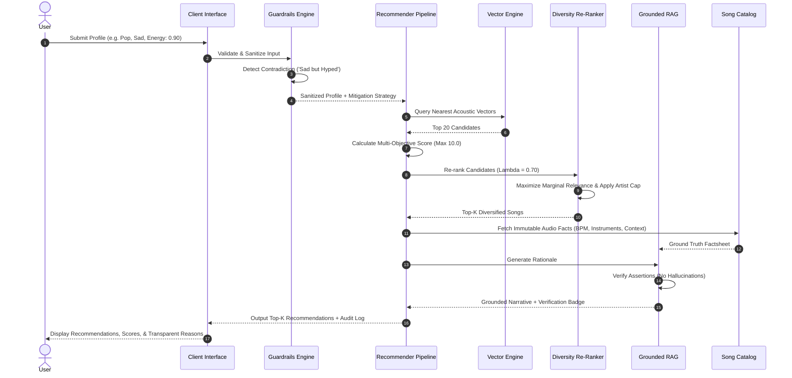
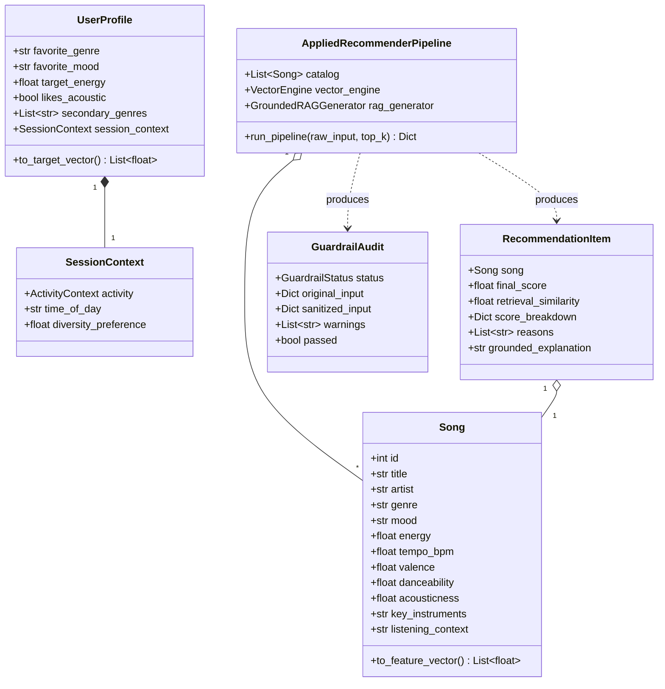
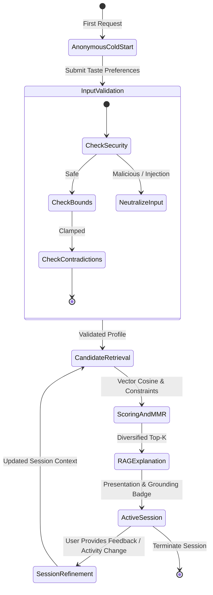

# 📐 Systems & Algorithms Specification: VibeCheck 2.0

## 1. Architectural Philosophy: Decomposing Vague Feature Requests

In music recommendation products, stakeholder requests are typically phrased in conversational, ambiguous language:
> *"Recommend good music that fits my vibe, adapt whether I'm studying or at the gym, explain why you picked it, don't repeat the same artist, don't make stuff up, and make sure it doesn't break when users do weird things."*

In VibeCheck 2.0, this vague request is rigorously decomposed into six testable, auditable system components:

```
┌─────────────────────────────────────────────────────────────────────────────┐
│                       USER REQUEST & INTERFACES                             │
│   (Terminal Interactive CLI / Zero-Dependency HTML5 Web UI / Python API)     │
└──────────────────────────────────────┬──────────────────────────────────────┘
                                       │ Raw Query & Session Context
                                       ▼
┌─────────────────────────────────────────────────────────────────────────────┐
│                      COMPONENT 1: INPUT GUARDRAILS                          │
│   - Injection Pattern Detection & Neutralization                            │
│   - Parameter Bounds Clamping (Target Energy [0.0, 1.0])                    │
│   - Orthographic & Typo Normalization (Fuzzy Genre Synonyms)                │
└──────────────────────────────────────┬──────────────────────────────────────┘
                                       │ Sanitized User Profile
                                       ▼
┌─────────────────────────────────────────────────────────────────────────────┐
│                  COMPONENT 2: CONFLICT RESOLUTION ENGINE                    │
│   - Contradiction Detection ('Sad but Hyped', 'Unplugged Metalhead')         │
│   - Acoustic Compromise Strategies & Secondary Taste Expansion              │
└──────────────────────────────────────┬──────────────────────────────────────┘
                                       │ Resolved Taste Profile & Vector Query
                                       ▼
┌─────────────────────────────────────────────────────────────────────────────┐
│              COMPONENT 3: HYBRID VECTOR & ATTRIBUTE RETRIEVAL               │
│   - 6D Acoustic Embedding Space (Energy, Tempo, Valence, Dance, Acoustic)   │
│   - Cosine Similarity Nearest Neighbor Filtering                            │
│   - Fast In-Memory Candidate Retrieval                                      │
└──────────────────────────────────────┬──────────────────────────────────────┘
                                       │ Top-20 High-Similarity Candidates
                                       ▼
┌─────────────────────────────────────────────────────────────────────────────┐
│                  COMPONENT 4: MULTI-OBJECTIVE SCORING                       │
│   - Calibrated Weights: Genre (2.5), Mood (2.0), Energy (2.5), Acoustic(1.5)│
│   - Acoustic Vector Harmony (1.5) -> Max 10.0 Points                        │
│   - Continuous Non-Linear Decay (Combats 1.0's Energy Filter Bubble)        │
└──────────────────────────────────────┬──────────────────────────────────────┘
                                       │ Scored Candidates
                                       ▼
┌─────────────────────────────────────────────────────────────────────────────┐
│            COMPONENT 5: MAXIMAL MARGINAL RELEVANCE (MMR) RE-RANKING         │
│   - Diversity vs. Relevance Balancing (Lambda = 0.70)                       │
│   - Intra-List Acoustic Distance Maximization (Increases ILD)               │
│   - Artist Frequency Constraint (Prevents Monopolies)                       │
└──────────────────────────────────────┬──────────────────────────────────────┘
                                       │ Top-K Diversified Recommendations
                                       ▼
┌─────────────────────────────────────────────────────────────────────────────┐
│               COMPONENT 6: GROUNDED RAG EXPLANATION PIPELINE                │
│   - Context Assembler: Binds verified catalog metadata to prompt facts      │
│   - Grounded RAG Generator: Synthesizes personalized listening rationale    │
│   - Hallucination Verifier: Cross-checks tempo, genre, acoustic claims      │
└──────────────────────────────────────┬──────────────────────────────────────┘
                                       │ Verified Recommendations & Explanations
                                       ▼
┌─────────────────────────────────────────────────────────────────────────────┐
│                        PRESENTATION & AUDIT LOGGING                         │
│       (Transparent Scores, Grounding Badges, Security Audit Trail)          │
└─────────────────────────────────────────────────────────────────────────────┘
```

---

## 2. System Structure Visualizations (UML)

### 2.1 Component Architecture Diagram



### 2.2 Sequence Diagram: End-to-End Recommendation Request



### 2.3 Class Diagram: Domain & Pipeline Models



### 2.4 State Diagram: Listener Session State Machine



---

## 3. Planned Algorithms (Formal Specifications)

### Algorithm 1: Multi-Dimensional Acoustic Vector Cosine Similarity
$$\vec{v}_{\text{song}} = \left[ \text{energy}, \frac{\text{tempo}}{200}, \text{valence}, \text{danceability}, \text{acousticness}, \text{instrumentalness} \right]$$
$$\text{Sim}(\vec{u}, \vec{v}) = \frac{\vec{u} \cdot \vec{v}}{\|\vec{u}\|_2 \|\vec{v}\|_2} = \frac{\sum_{i=1}^{d} u_i v_i}{\sqrt{\sum_{i=1}^{d} u_i^2} \sqrt{\sum_{i=1}^{d} v_i^2}}$$

### Algorithm 2: Continuous Multi-Objective Scoring
To prevent the catastrophic energy filter bubble where energy dominated 57% of all points in VibeCheck 1.0, VibeCheck 2.0 uses calibrated multi-criteria weighting:

$$S(u, s) = w_g \cdot \mathbb{I}_{\text{genre}}(u, s) + w_m \cdot \mathbb{I}_{\text{mood}}(u, s) + w_e \cdot (1 - |\text{energy}_s - \text{energy}_u|) + w_a \cdot (1 - |\text{acoust}_s - \text{acoust}_u|) + w_v \cdot \frac{\text{Sim}(\vec{u}, \vec{s}) + 1}{2}$$

Where:
- $w_g = 2.5$ (Genre affinity)
- $w_m = 2.0$ (Mood alignment)
- $w_e = 2.5$ (Energy closeness)
- $w_a = 1.5$ (Acoustic distance)
- $w_v = 1.5$ (6D Vector cosine similarity)
- Total Maximum Score = $10.0$.

### Algorithm 3: Maximal Marginal Relevance (MMR)
Given candidate pool $R$ and selected set $S$, iteratively select song $d^*$:
$$d^* = \arg\max_{d \in R \setminus S} \left[ \lambda \cdot \text{Rel}(d, u) - (1 - \lambda) \cdot \max_{d_s \in S} \text{Sim}(d, d_s) \right]$$
Subject to:
$$\text{Count}(\text{artist}(d), S) < \text{MaxPerArtist} \quad (\text{Default: } 2)$$

Where $\lambda = 0.70$ balances personalized relevance with acoustic variety, preventing single-artist and single-tempo clustering.

### Algorithm 4: Factual Grounding & Hallucination Guardrail
Let $E$ be the generated rationale text, and let $F(s)$ be the ground-truth attribute tuple:
$$F(s) = (\text{genre}_s, \text{BPM}_s, \text{energy}_s, \text{acousticness}_s, \text{instruments}_s)$$
The verification function $\mathcal{V}(E, F(s))$ applies deterministic NLP assertion checking:
1. Genre consistency: $\forall g \in \mathcal{G}, \text{mention}(g, E) \implies g = \text{genre}_s$.
2. Tempo consistency: $\text{mention}("fast", E) \implies \text{BPM}_s \ge 90$; $\text{mention}("slow", E) \implies \text{BPM}_s \le 130$.
3. Acoustic consistency: $\text{mention}("all acoustic", E) \implies \text{acousticness}_s \ge 0.5$.
4. Metadata citation badge: $E \leftarrow E \oplus \text{Badge}(F(s))$.
